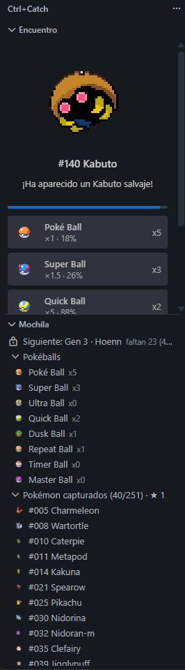
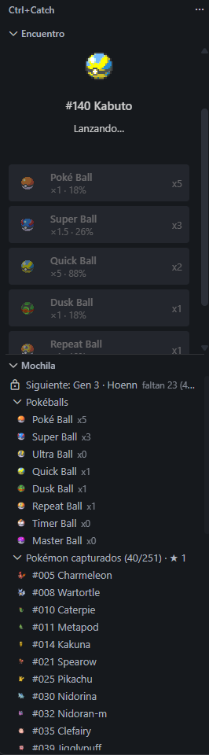
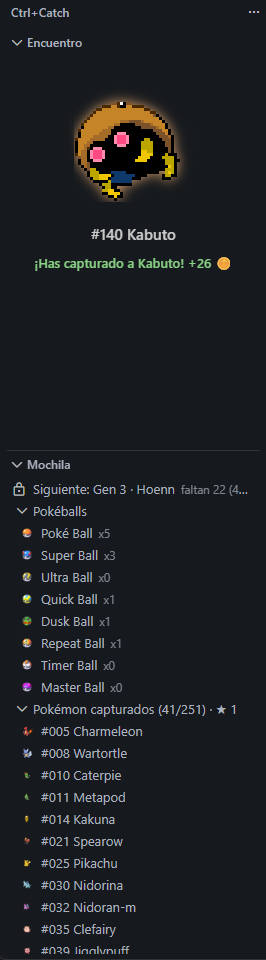

# Ctrl+Catch

**Guarda tu código, captura Pokémon.** Un pequeño juego de fans que vive en VS Code mientras programas.

> Proyecto de fans, no oficial y gratuito. No está afiliado ni respaldado por Nintendo, Game Freak ni The Pokémon Company. Pokémon y sus imágenes son marcas y material de sus respectivos propietarios. Los datos y sprites se cargan desde [PokéAPI](https://pokeapi.co) y no vienen incluidos en la extensión.

| ¡Aparece un Pokémon salvaje! | Lanzas una ball… | ¡Capturado! |
|:---:|:---:|:---:|
|  |  |  |

## Cómo se juega

1. **Programa y guarda.** Cada vez que guardas un archivo con texto nuevo escrito por ti, ganas monedas 🪙 (1 por cada 20 caracteres).
2. **Aparece un Pokémon salvaje.** A veces, al guardar, sale uno en el panel *Encuentro* de la barra lateral. Tienes 45 segundos para decidir.
3. **Lanza una ball.** Elige cuál: cada botón muestra la probabilidad de captura de ese lanzamiento. Si falla, puede que el Pokémon siga ahí… o que huya.
4. **Compra más balls.** Pulsa el contador de monedas de la barra de estado para abrir la tienda.
5. **Completa tu colección.** Captura suficientes especies distintas para desbloquear la siguiente generación, de Kanto a Paldea.

Si ves un Pokémon con destellos ★, es un **variocolor** (1 de cada 50): da 50 monedas extra y no se puede vender.

## Balls

| Ball | Precio | Efecto |
|---|---|---|
| Poké Ball | 10 | ×1 |
| Super Ball | 30 | ×1.5 |
| Dusk Ball | 40 | ×3 de noche (20:00–06:00) |
| Timer Ball | 40 | Sube ×0.5 por cada lanzamiento, hasta ×4 |
| Repeat Ball | 50 | ×3.5 si ya tienes esa especie |
| Ultra Ball | 70 | ×2 |
| Quick Ball | 80 | ×5 en el primer lanzamiento |
| Master Ball | 1000 | Captura segura |

## Mochila

En la barra de actividad, el icono de Ctrl+Catch abre la *Mochila*, con:

- El progreso hacia la siguiente generación.
- Tus balls.
- Tus estadísticas: tu **racha** de días seguidos programando, caracteres escritos, monedas ganadas y gastadas, encuentros, porcentaje de captura…
- Tus Pokémon capturados. Los repetidos tienen un botón para **venderlos** y recuperar monedas, y todos uno para **evolucionarlos** (⬆).

## Evoluciones

Los Pokémon de la *Mochila* que pueden evolucionar muestran un botón ⬆ (tarda un momento en aparecer la primera vez, mientras consulta la PokéAPI). Púlsalo para evolucionarlo pagando monedas (de 30 a 150, según lo difícil que sea la evolución). Si tiene varias (como Eevee), eliges cuál. Se gasta una copia, el variocolor se conserva, y solo puedes evolucionar a Pokémon de generaciones ya desbloqueadas.

## Pokédex

Pulsa el botón 📖 de la cabecera de la *Mochila* (o el comando *Ctrl+Catch: Abrir Pokédex*) para ver tu colección en grande:

- Las especies que has capturado aparecen en color, con cuántas tienes y una ★ si tienes su variocolor.
- Las que te faltan se ven solo como silueta.
- Progreso total y por generación, con filtros *Todos*, *Capturados* y *Me faltan*.

## Comandos

- **Ctrl+Catch: Abrir Pokédex**
- **Ctrl+Catch: Abrir tienda**
- **Ctrl+Catch: Pausar o reanudar**: sin monedas ni encuentros mientras está en pausa (también con el botón ⏸ de la barra de estado).
- **Ctrl+Catch: Sincronizar partida ahora**
- **Ctrl+Catch: Reiniciar progreso**

## Ajustes

- **`pokemonCompanion.encounterChance`**: probabilidad de encuentro tras un guardado que da monedas (de 0.05 a 1; por defecto 0.25).
- **`pokemonCompanion.encounterCooldownSeconds`**: segundos mínimos entre encuentros (de 10 a 3600; por defecto 60).
- **`pokemonCompanion.syncFolder`**: carpeta de sincronización (ver abajo).

## Jugar en varios ordenadores

La partida se guarda en un archivo `partida.json` dentro de una carpeta compartida:

- Por defecto, `OneDrive/PokemonCompanion`.
- O la carpeta que indiques en el ajuste **`pokemonCompanion.syncFolder`** (Dropbox, Google Drive, una carpeta de red…).

Se sincroniza al abrir VS Code, al volver a la ventana, unos segundos después de cada cambio y al cerrar. Si la partida ha cambiado en dos ordenadores a la vez, puedes **combinarlas**: se juntan las capturas de los dos, se suman las monedas y balls ganadas o gastadas en cada uno, y se quitan los repetidos que vendiste. También puedes quedarte con una de las dos.

## Privacidad

- No hay telemetría.
- Solo se conecta a `pokeapi.co` y a `raw.githubusercontent.com` para descargar los datos y sprites de los Pokémon.
- No se lee el contenido de tus archivos: solo se cuenta cuántos caracteres añades.

## Licencia

Código bajo licencia [MIT](LICENSE).
